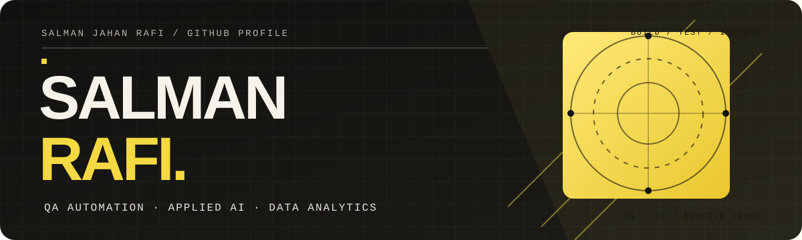
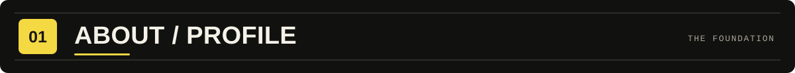
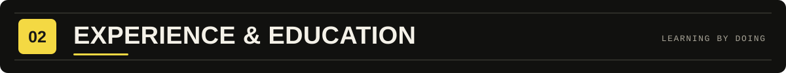
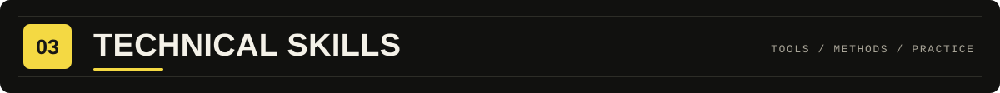
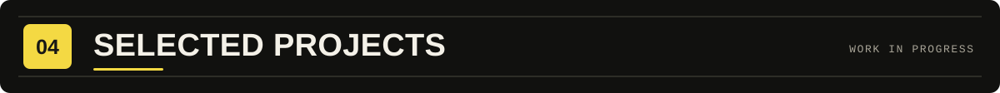
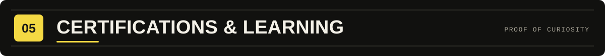
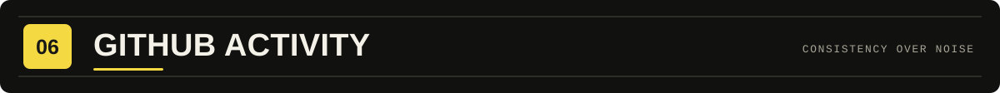
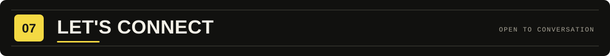
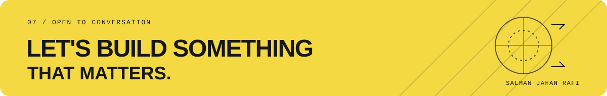

  

  <a href="#about">01 / ABOUT</a> &nbsp; · &nbsp;
  <a href="#experience">02 / EXPERIENCE</a> &nbsp; · &nbsp;
  <a href="#skills">03 / SKILLS</a> &nbsp; · &nbsp;
  <a href="#projects">04 / PROJECTS</a> &nbsp; · &nbsp;
  <a href="#learning">05 / LEARNING</a> &nbsp; · &nbsp;
  <a href="#activity">06 / ACTIVITY</a> &nbsp; · &nbsp;
  <a href="#contact">07 / CONTACT</a>

  
  
  
  

---

  

<table>
  <tr>
    <td width="24%" align="center" valign="middle">
      
       
      <strong>Salman Jahan Rafi</strong>
       
      Information & Communication Engineering
    </td>
    <td width="76%" valign="middle">
      I’m an Information and Communication Engineering graduate from <strong>Bangladesh University of Professionals</strong>, interested in building reliable software, practical AI applications, and useful data solutions.
        
      My work brings together <strong>Quality Assurance, test automation, applied AI, and data analytics</strong>. I enjoy understanding how systems behave, identifying where they can fail, and improving them through structured testing and problem-solving.
        
      <strong>Current focus</strong> 
      Playwright and API automation · AI-powered applications · Document intelligence · Data-driven problem solving
    </td>
  </tr>
</table>

  

| Period | Role | Team / Organisation |
|:--|:--|:--|
| **Jul 2026 – Present** | Data Analyst | Data Engineer Team · Rooya Bangladesh |
| **May 2026 – Jul 2026** | QA Engineer | Quality Assurance Team · Dream71 Bangladesh Limited |
| **Dec 2024 – Feb 2025** | Intern | In-House Software Development Team · Trust Bank PLC |

**Education**

**B.Sc. in Information and Communication Engineering**  
Bangladesh University of Professionals · 2025  
CGPA: **3.59 / 4.00**

  

**Quality Engineering & Test Automation**

  
  
  
  
  
  
  

**Programming & Data**

  
  
  
  
  
  
  

**Applied AI, Backend & Web**

  
  
  
  
  
  

  
<strong>Explore the wider toolkit</strong>

   
  <table>
    <tr><td><strong>Testing methods</strong></td><td>Functional Testing · Regression Testing · Test Case Design · API Testing · End-to-End Testing</td></tr>
    <tr><td><strong>AI & machine learning</strong></td><td>RAG · LLM Integration · Gemini API · NLP · CNN</td></tr>
    <tr><td><strong>Data & visualisation</strong></td><td>Exploratory Data Analysis · Matplotlib · Seaborn · Power BI</td></tr>
    <tr><td><strong>Web technologies</strong></td><td>HTML · CSS · PHP · REST APIs</td></tr>
    <tr><td><strong>Tools & delivery</strong></td><td>Git · GitHub Actions · CI/CD · Jira · Trello · Jupyter Notebook · Google Colab</td></tr>
  </table>

  

<table>
  <tr>
    <td width="50%" valign="top">
      <h3><a href="https://github.com/Rafi7078/verifyrest-automation-framework">01 / VerifyREST ↗</a></h3>
      
A REST API automation framework for the Restful-Booker workflow. Covers health checks, authentication, booking creation, retrieval, updates, deletion, and response validation.

      
<strong>8 requests · 42 assertions</strong>

      
      
      
    </td>
    <td width="50%" valign="top">
      <h3><a href="https://github.com/Rafi7078/ecommerce-playwright-automation">02 / E-Commerce Playwright Automation ↗</a></h3>
      
An end-to-end UI automation framework for an e-commerce user journey, including login, product search, product details, cart, checkout, and payment.

      
<strong>8 automated tests · Page Object Model</strong>

      
      
      
    </td>
  </tr>
  <tr>
    <td width="50%" valign="top">
      <h3><a href="https://github.com/Rafi7078/peoplemind-ai">03 / PeopleMind AI ↗</a></h3>
      
A local-first HR intelligence assistant combining document Q&amp;A with source citations, CV intelligence, attendance operations, and HR reporting.

      
<strong>RAG · Local AI · HR workflow support</strong>

      
      
      
      
    </td>
    <td width="50%" valign="top">
      <h3><a href="https://github.com/Rafi7078/Human_Brain_Tumor_Detect">04 / Brain Tumor Detection ↗</a></h3>
      
An Android-based brain tumour detection project using a TensorFlow Lite model for on-device inference.

      
<strong>Computer vision · Mobile application</strong>

      
      
    </td>
  </tr>
  <tr>
    <td width="50%" valign="top">
      <h3><a href="https://github.com/Rafi7078/amazon-sales-analysis-powerbi-dashboard">05 / Amazon Sales Analysis ↗</a></h3>
      
A Power BI dashboard exploring sales performance, product categories, customer reviews, revenue trends, and business KPIs.

      
<strong>Business intelligence · Data visualisation</strong>

      
      
    </td>
    <td width="50%" valign="top">
      <h3><a href="https://github.com/Rafi7078/powerbi-hr-analytics-dashboard">06 / HR Analytics Dashboard ↗</a></h3>
      
A workforce analytics dashboard covering employee attrition, salary distribution, age groups, gender patterns, and job-role insights.

      
<strong>HR analytics · Business intelligence</strong>

      
      
    </td>
  </tr>
</table>

  <a href="https://github.com/Rafi7078?tab=repositories"><strong>EXPLORE ALL REPOSITORIES ↗</strong></a>

  

| Learning / Credential | Provider |
|:--|:--|
| Playwright & TypeScript Test Automation | Simplilearn SkillUp |
| Microsoft SQL Foundations | Microsoft / Coursera |
| Deloitte Data Analytics Simulation Program | Deloitte |
| Excel Essentials for Workplace Productivity | Passport to Earning Bangladesh (UNICEF) |

I approach learning as an ongoing process: understand the fundamentals, apply them in projects, and improve through feedback and practice.

  

  
  &nbsp;
  

  

  

These analytics are generated from public GitHub activity and may take time to refresh.

  
    
  
    
  
  
  

  Build with intention. Test with care. Improve continuously.

