<!--
GitHub Profile README — Salman Jahan Rafi (@Rafi7078)
Visual direction: aligned with the portfolio's midnight-navy, electric-cyan and editorial identity.
All project claims and credentials are based on the supplied profile assets and repository README.
-->

  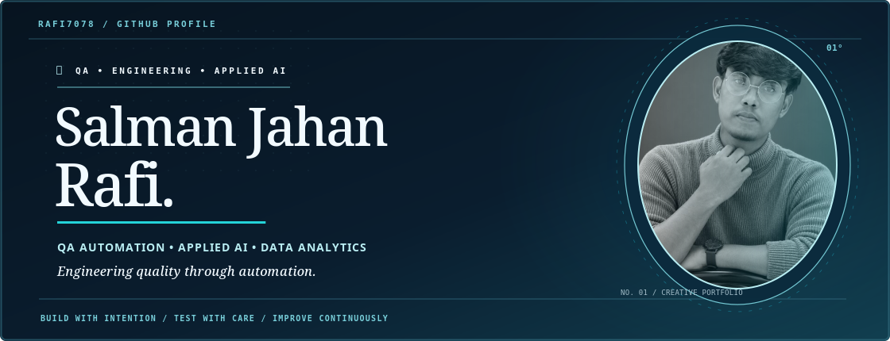

  
  
  
  
  
  

  

---

  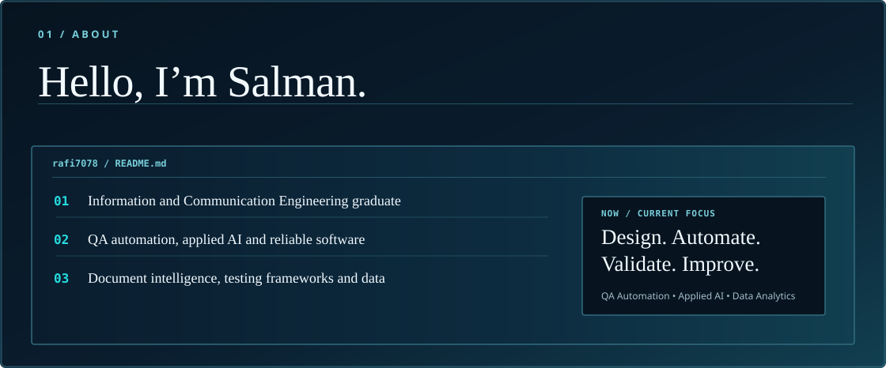

  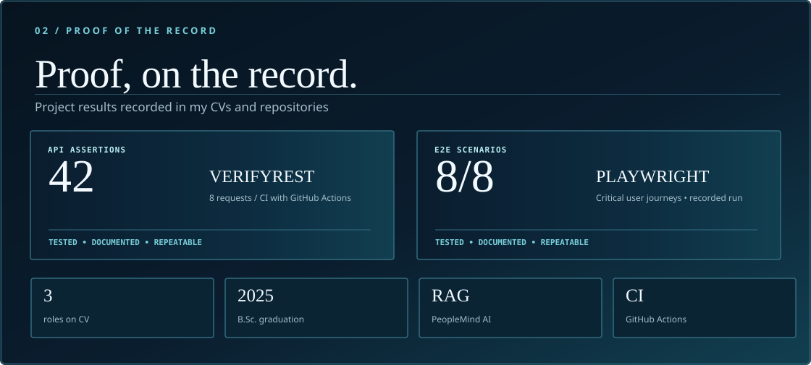

---

  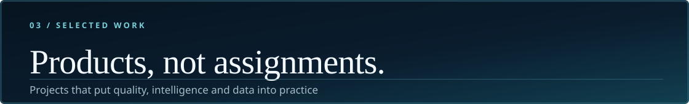

  <a href="https://github.com/Rafi7078/peoplemind-ai">
    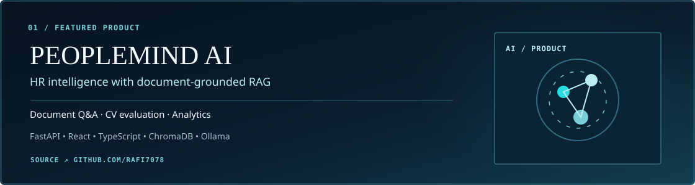
  </a>

  <a href="https://github.com/Rafi7078?tab=repositories">
    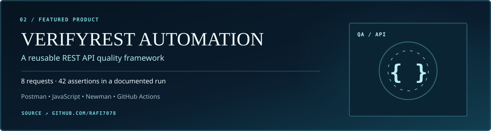
  </a>

  <a href="https://github.com/Rafi7078/ecommerce-playwright-automation">
    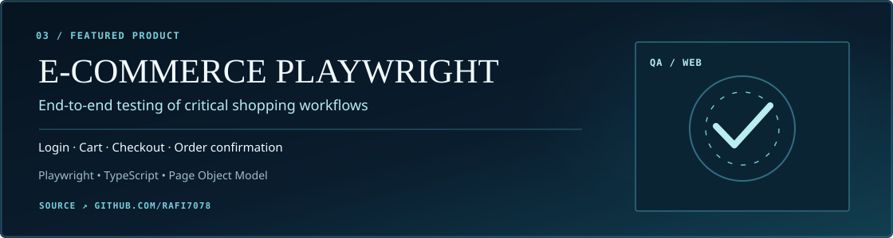
  </a>

  <a href="https://github.com/Rafi7078/Human_Brain_Tumor_Detect">
    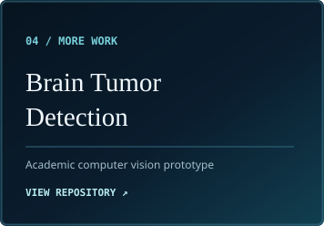
  </a>
  <a href="https://github.com/Rafi7078/powerbi-ecommerce-sales-dashboard">
    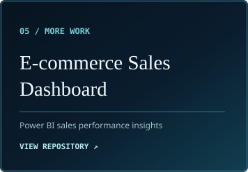
  </a>
  <a href="https://github.com/Rafi7078/powerbi-hr-analytics-dashboard">
    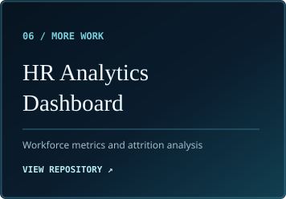
  </a>

  <a href="https://github.com/Rafi7078?tab=repositories">Explore all repositories →</a>

---

  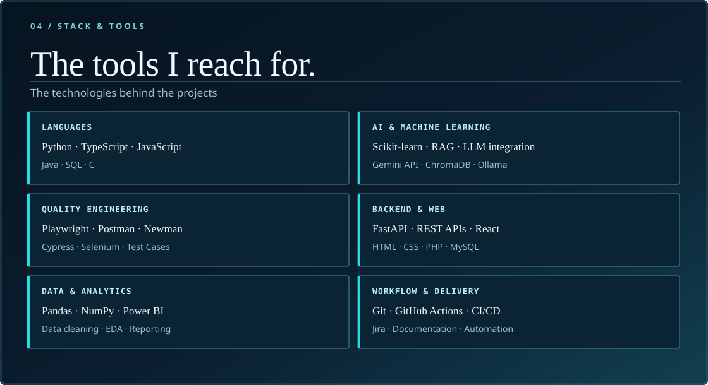

---

  <a href="https://github.com/Rafi7078?tab=overview">
    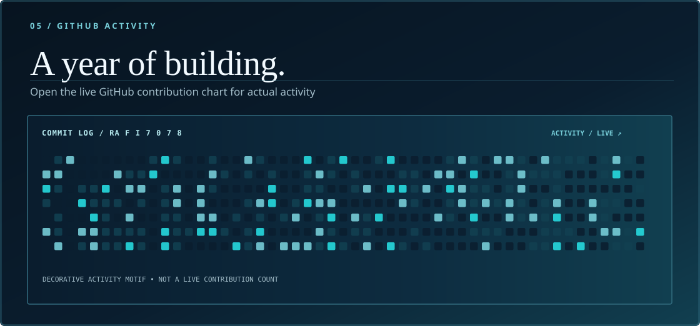
  </a>

  <a href="https://github.com/Rafi7078?tab=overview">View my live GitHub activity →</a>

---

  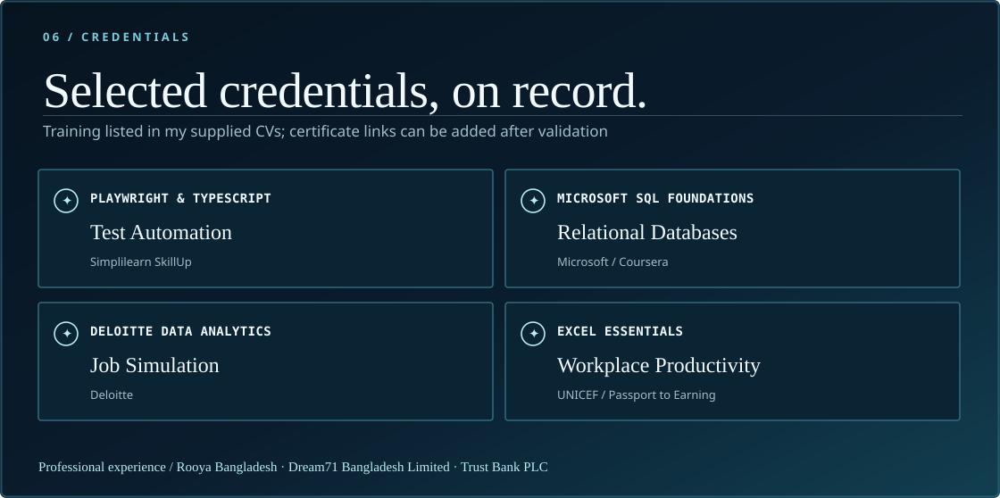

---

  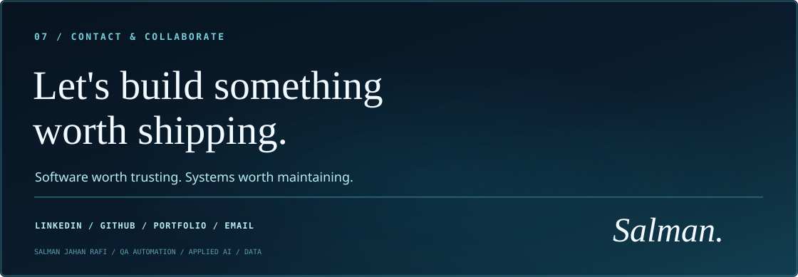

  
  
  
  

  <a href="#top">Back to top ↑</a>

