<!--
SRI-TECH VIDEO REFERENCE MATCH — Rafi7078 GitHub Profile
The reference is a screen-recorded visual, not supplied HTML/CSS/source assets.
This is a faithful original reconstruction of the filmed layout, not a pixel-perfect copy.
Public data based on user-provided CVs, profile screenshots and repositories.
No phone, private information, fabricated awards, activity counts or API tokens.
-->

  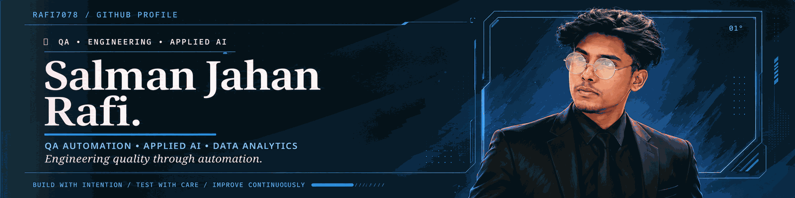

  
  
  
  
  
  

<!-- Keep the looping signature line specifically requested by Salman. -->

  

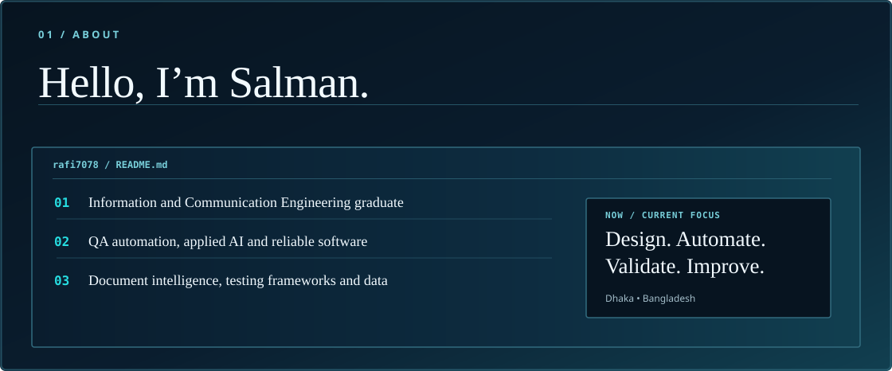

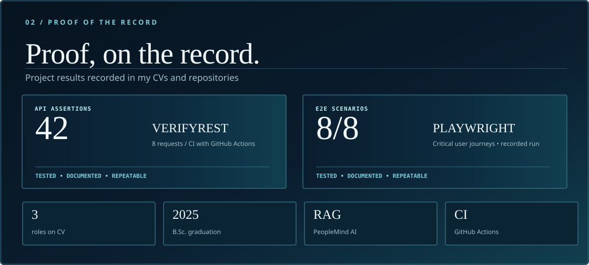

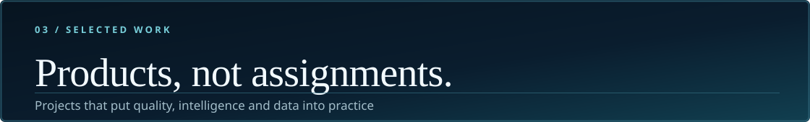

<a href="https://github.com/Rafi7078/peoplemind-ai">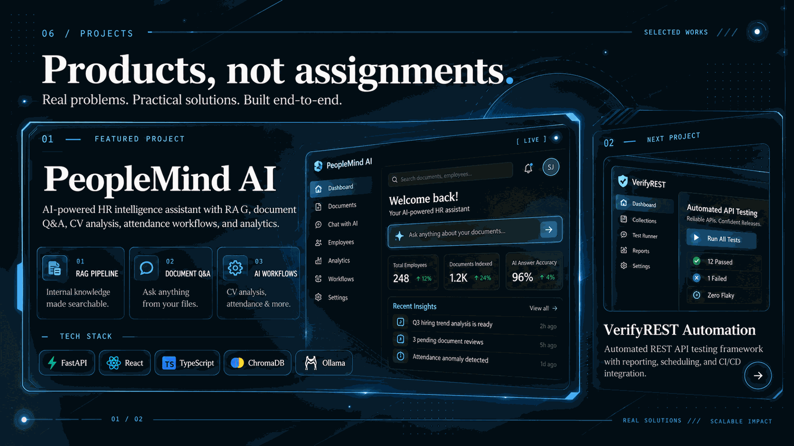</a>
<a href="https://github.com/Rafi7078/ecommerce-playwright-automation">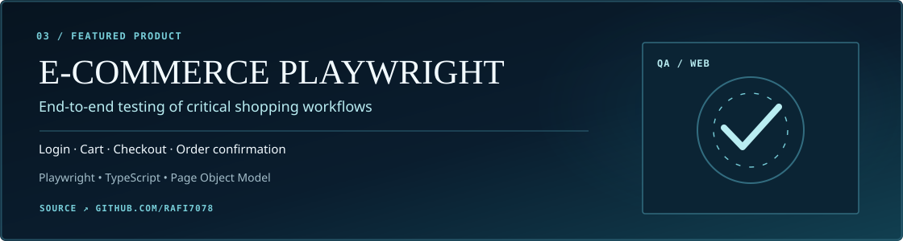</a>

  <a href="https://github.com/Rafi7078/Human_Brain_Tumor_Detect">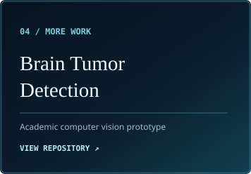</a>
  <a href="https://github.com/Rafi7078/powerbi-ecommerce-sales-dashboard">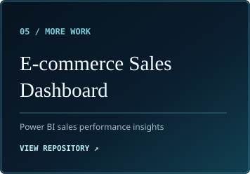</a>
  <a href="https://github.com/Rafi7078/powerbi-hr-analytics-dashboard">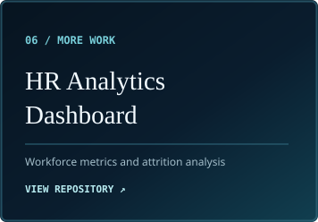</a>

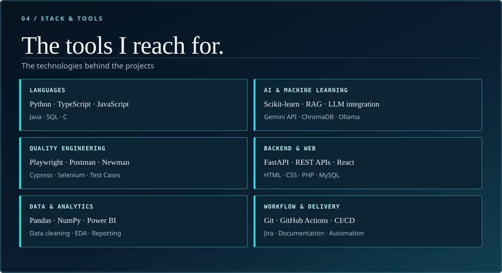

<a href="https://github.com/Rafi7078?tab=overview">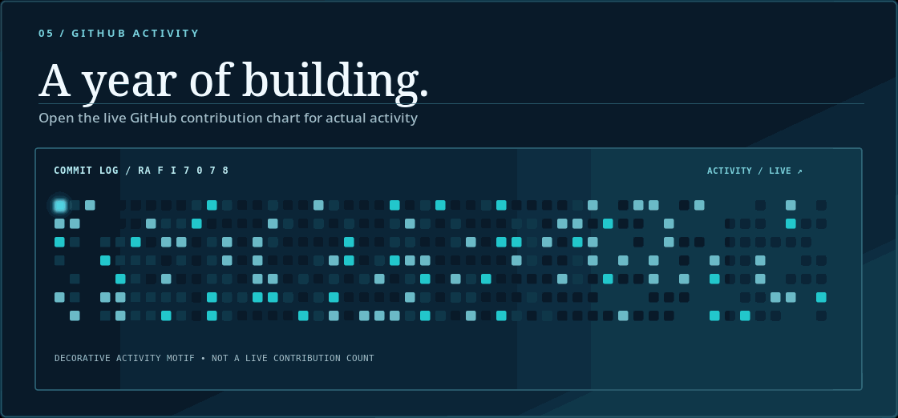</a>

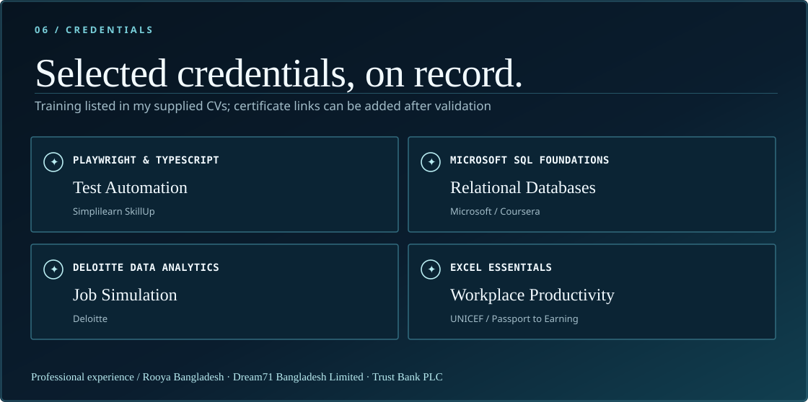

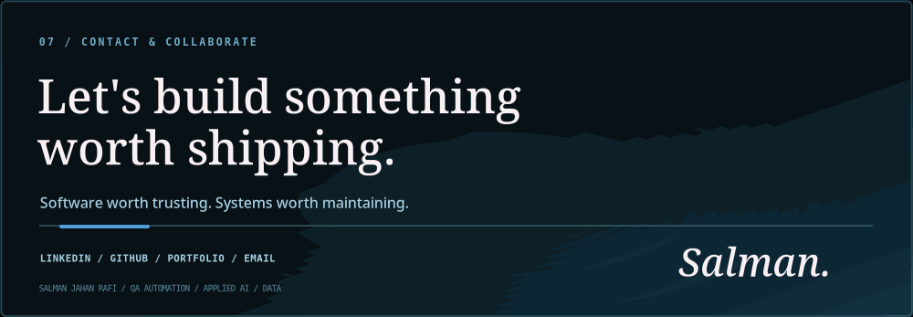

  
  
  
  

<a href="#top">Back to top ↑</a>

