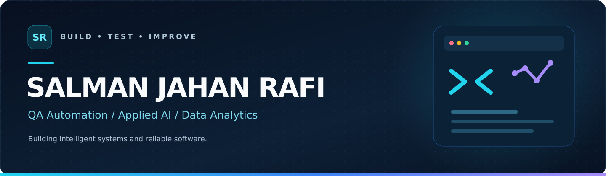
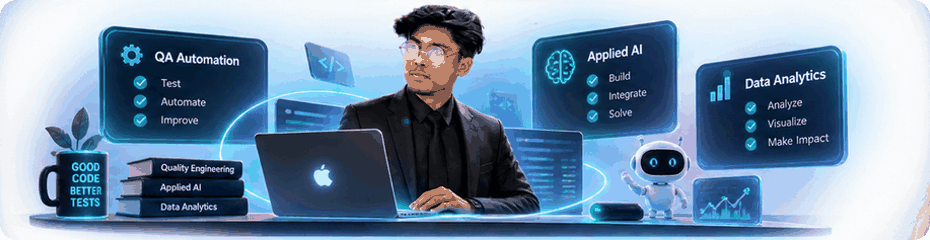
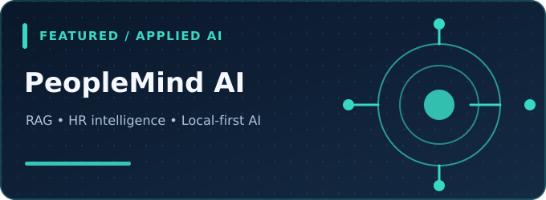
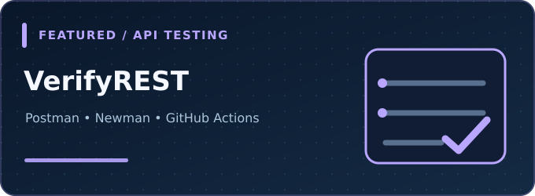
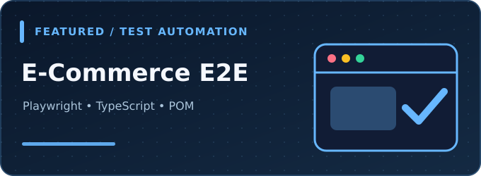
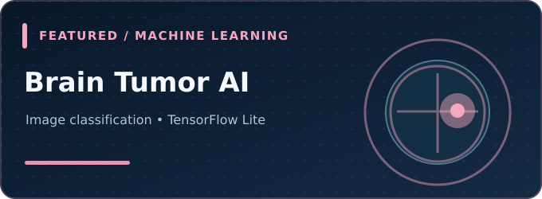

<!-- GitHub profile README for https://github.com/Rafi7078 -->

  

  
  
  

<!-- Subtle looped 3D-style avatar animation: GitHub supports animated GIFs in README -->

  

  

## About me

I'm **Salman Jahan Rafi**, an Information and Communication Engineering graduate who enjoys working where **software quality, applied AI, and data** intersect. I build practical applications, automate repetitive testing workflows, and use data to solve real problems.

- **Quality engineering:** UI and API testing, test design, end-to-end automation, regression testing, and CI workflows.
- **Applied AI:** RAG, local LLMs, document intelligence, predictive modeling, and Python-based applications.
- **Data and analytics:** SQL, exploratory data analysis, reporting, and Power BI dashboards.
- **Currently exploring:** More reliable CI/CD pipelines, scalable test frameworks, and trustworthy AI applications.

> My focus: build things that are useful, testable, and maintainable.

## Selected work

<table>
  <tr>
    <td width="50%" valign="top">
      
      <h3><a href="https://github.com/Rafi7078/peoplemind-ai">PeopleMind AI</a></h3>
      
Local-first HR intelligence app with PDF-based RAG Q&amp;A, candidate analysis, attendance workflows, and analytics.

      
<strong>Stack:</strong> FastAPI · React · TypeScript · ChromaDB · Ollama

      
<a href="https://github.com/Rafi7078/peoplemind-ai">Explore project ↗</a>

    </td>
    <td width="50%" valign="top">
      
      <h3><a href="https://github.com/Rafi7078/verifyrest-automation-framework">VerifyREST Automation</a></h3>
      
Automated REST API checks covering authentication, CRUD workflows, response assertions, reporting, and CI.

      
<strong>Proof of work:</strong> 8 requests · 42 automated assertions

      
<a href="https://github.com/Rafi7078/verifyrest-automation-framework">Explore project ↗</a>

    </td>
  </tr>
  <tr>
    <td width="50%" valign="top">
      
      <h3><a href="https://github.com/Rafi7078/ecommerce-playwright-automation">E-Commerce E2E Automation</a></h3>
      
Reusable Playwright tests for shopping flows, including authentication, product browsing, cart, and checkout.

      
<strong>Stack:</strong> Playwright · TypeScript · Page Object Model

      
<a href="https://github.com/Rafi7078/ecommerce-playwright-automation">Explore project ↗</a>

    </td>
    <td width="50%" valign="top">
      
      <h3><a href="https://github.com/Rafi7078/Human_Brain_Tumor_Detect">Brain Tumor Detection Prototype</a></h3>
      
An academic AI prototype exploring image-based classification using TensorFlow Lite; not intended for clinical use.

      
<strong>Focus:</strong> Machine learning · Medical imaging · Inference

      
<a href="https://github.com/Rafi7078/Human_Brain_Tumor_Detect">Explore project ↗</a>

    </td>
  </tr>
</table>

### More projects

- [**Telecom Customer Churn Analysis**](https://github.com/Rafi7078/telecom-customer-churn-analysis) — Customer behavior insights with Python, Pandas, Matplotlib, and Seaborn.
- [**Online Course Engagement Analysis**](https://github.com/Rafi7078/Online-Course-Engagement-Analysis) — Exploratory analysis of learner activity and course completion.
- [**Amazon Sales Dashboard**](https://github.com/Rafi7078/amazon-sales-analysis-powerbi-dashboard) — Interactive business KPIs and sales trends with Power BI.
- [**HR Analytics Dashboard**](https://github.com/Rafi7078/powerbi-hr-analytics-dashboard) — Workforce insights and attrition analysis with Power BI.
- [**Cypress E2E Testing**](https://github.com/Rafi7078/End-to-End-Testing-with-Cypress) — Authentication test scenarios and web UI automation.

## Toolbox

**AI, machine learning, and backend**

**QA automation and continuous testing**

**Data, development, and collaboration**

## Practical highlights

| Quality automation | Applied AI | Data-driven solutions |
| :--- | :--- | :--- |
| **42 API assertions** documented in VerifyREST | **RAG-backed document assistant** in PeopleMind AI | **SQL, EDA, and dashboards** across analytics projects |
| API + E2E testing with reusable workflows | Retrieval, local inference, and evidence-based outputs | Business insights through visualization and analysis |

<strong>GitHub activity (dynamic, third-party widget)</strong>

 

  

<em>This card uses an external service and may occasionally be unavailable.</em>

## Let's connect

I'm always interested in thoughtful discussions about **quality engineering, AI applications, and data-driven software**.

- **LinkedIn:** [linkedin.com/in/salmanrafi002](https://www.linkedin.com/in/salmanrafi002/)
- **Email:** [sajidbin7777@gmail.com](mailto:sajidbin7777@gmail.com)
- **GitHub:** [github.com/Rafi7078](https://github.com/Rafi7078)

Built around real projects, practical learning, and continuous improvement.

