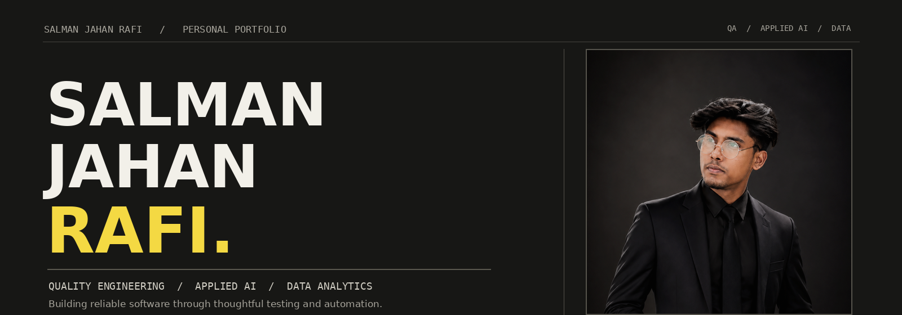
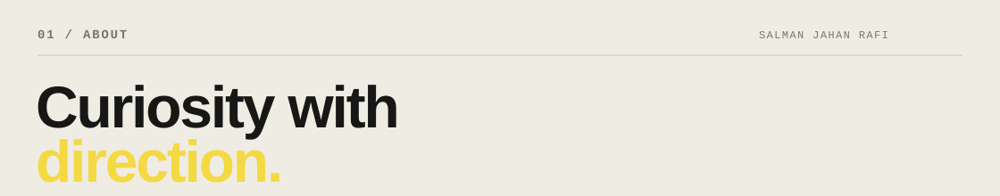
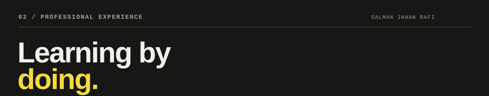
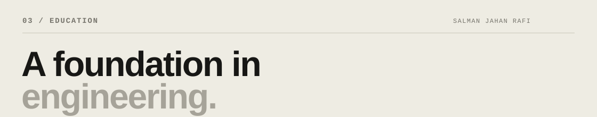
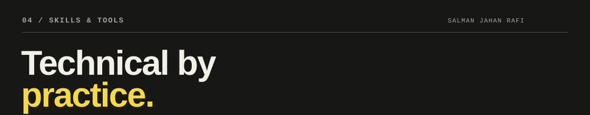
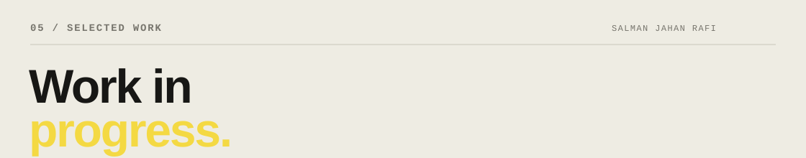
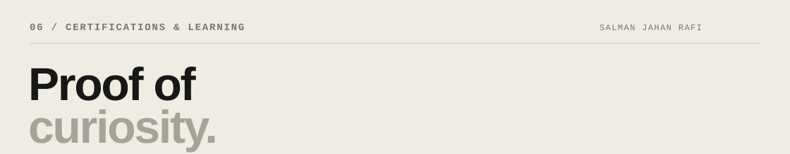
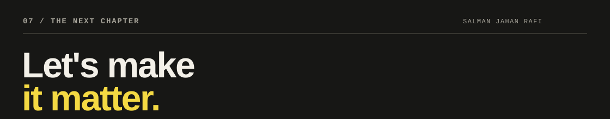

  

  <a href="https://salman-rafi-website.vercel.app/">PORTFOLIO ↗</a>
  &nbsp; / &nbsp;
  <a href="https://www.linkedin.com/in/salmanrafi002/">LINKEDIN ↗</a>
  &nbsp; / &nbsp;
  <a href="https://github.com/Rafi7078?tab=repositories">REPOSITORIES ↗</a>
  &nbsp; / &nbsp;
  <a href="mailto:sajidbin7777@gmail.com">EMAIL ↗</a>

---

  

I’m **Salman Jahan Rafi**, an Information and Communication Engineering graduate from **Bangladesh University of Professionals**.

My work sits at the intersection of **software quality assurance, test automation, applied AI and data analytics**. I enjoy understanding how systems behave, finding where they can fail, and building practical ways to make them more reliable.

**Current focus:** Playwright and API automation, AI-powered applications, document intelligence, and data-driven problem solving.

  

| Period | Role | Organisation |
|---|---|---|
| Jul 2026 – Present | Data Analyst, Data Engineer Team | Rooya Bangladesh |
| May 2026 – Jul 2026 | QA Engineer, Quality Assurance Team | Dream71 Bangladesh Limited |
| Dec 2024 – Feb 2025 | Intern, In-House Software Development Team | Trust Bank PLC |

My experience includes data review and validation, manual and automated software testing, test-case preparation, regression testing, API testing, and web application development support.

  

**B.Sc. in Information and Communication Engineering**
Bangladesh University of Professionals · 2025
CGPA: **3.59 / 4.00**

  

**Quality Engineering**
Playwright · TypeScript · Cypress · Selenium · Postman · Newman · API Testing · Functional Testing · Regression Testing · Test Case Design

**Programming**
Python · JavaScript · TypeScript · Java · C · SQL

**Applied AI & Machine Learning**
RAG · LLM Integration · Gemini API · ChromaDB · Ollama · Scikit-learn · NLP · CNN

**Data & Analytics**
Pandas · NumPy · Power BI · Matplotlib · Seaborn · Exploratory Data Analysis

**Backend & Web**
FastAPI · REST APIs · React · HTML · CSS · PHP · MySQL

**Tools & Delivery**
Git · GitHub Actions · CI/CD · Jira · Trello · Jupyter Notebook · Google Colab

  

**01 / [VerifyREST — REST API Automation Framework](https://github.com/Rafi7078/verifyrest-automation-framework)**
A reusable Postman, JavaScript and Newman framework covering 8 API requests and 42 assertions, with GitHub Actions CI and HTML reporting.

**02 / [E-Commerce Playwright Automation](https://github.com/Rafi7078/ecommerce-playwright-automation)**
An end-to-end UI automation framework built with Playwright, TypeScript and the Page Object Model, covering 8 critical shopping scenarios.

**03 / [PeopleMind AI — HR Intelligence Assistant](https://github.com/Rafi7078/peoplemind-ai)**
A full-stack HR application using FastAPI, React, TypeScript, ChromaDB and LLM-based retrieval for document-grounded HR assistance.

**04 / [Brain Tumor Detection using AI](https://github.com/Rafi7078/Human_Brain_Tumor_Detect)**
An academic computer-vision project focused on brain-tumour detection and localisation from medical images.

**05 / [Amazon Sales Analysis — Power BI](https://github.com/Rafi7078/amazon-sales-analysis-powerbi-dashboard)**
An interactive dashboard for sales performance, product trends and business KPIs.

**06 / [HR Analytics Dashboard — Power BI](https://github.com/Rafi7078/powerbi-hr-analytics-dashboard)**
A workforce analytics dashboard exploring attrition, demographics, salary distribution and job-role trends.

[Explore all repositories →](https://github.com/Rafi7078?tab=repositories)

  

- **Playwright & TypeScript Test Automation** — Simplilearn SkillUp
- **Microsoft SQL Foundations** — Microsoft / Coursera
- **Deloitte Data Analytics Simulation Program** — Deloitte
- **Excel Essentials for Workplace Productivity** — Passport to Earning Bangladesh (UNICEF)

  

I’m interested in opportunities and collaborations involving **quality engineering, test automation, applied AI and data**.

  <a href="https://salman-rafi-website.vercel.app/">PORTFOLIO</a>
  &nbsp; · &nbsp;
  <a href="https://www.linkedin.com/in/salmanrafi002/">LINKEDIN</a>
  &nbsp; · &nbsp;
  <a href="mailto:sajidbin7777@gmail.com">EMAIL</a>
  &nbsp; · &nbsp;
  <a href="https://github.com/Rafi7078">GITHUB</a>

Build with intention. Test with care. Improve continuously.

